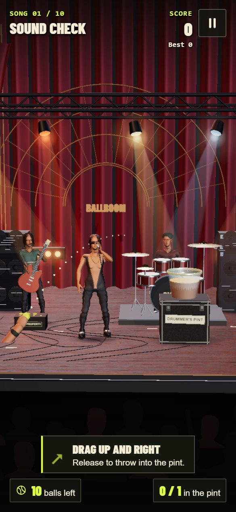

# Iggy Pop Tennis Ball Riot

A mobile-first Three.js arcade game. Drag up and right from the front row to land a tennis ball in the drummer’s pint. The ten-song set goes from an open sound check to a crowded finale requiring eight makes from ten balls.



## Play locally

Use Node.js 22 or 24 and npm.

```sh
npm ci
npm run dev
```

Open the local URL printed by Vite. A phone on the same Wi-Fi can use the server’s Network URL if your firewall permits the connection. Use the HTTPS Vercel deployment for home-screen installation and offline caching.

## Deploy on Vercel

Push the project files, including `public/`, both credits documents and `package-lock.json`, to your Git repository. Import the repository in Vercel with these settings. If this is an existing Vercel project linked to your branch, pushing the branch triggers its configured deployment.

| Setting | Value |
| --- | --- |
| Root directory | Project root |
| Framework preset | Vite |
| Install command | `npm ci` |
| Build command | `npm run build` |
| Output directory | `dist` |

All game assets, decoders and fonts ship with the static site. No API keys or backend services are required.

## Controls and rules

- Drag toward the arc and release. Drag distance sets power. A tap or an interrupted drag spends zero balls. Wait for the singer to pass and watch the directional crowd cue.
- Switch to **Aim & Throw** in Settings for angle and power sliders. Keyboard players can use Left/Right for angle, Up/Down for power, Space to throw and Escape to pause.
- Each make earns a base 100 points. Consecutive makes multiply that base by 1, 1.5, 2 and then 3. Clean shots add 50, a single bank adds 25 and multiple banks add 100. Clear a song in fewer than five throws for another 100.
- Reach the target before the ball supply runs out. The last ball can win the song. Retrying restores the score at the entrance to that level. Personal best and settings are stored on the device.

## Graphics and audio

The stage uses WebGL2, meshopt-compressed human meshes, KTX2 textures, a studio HDR environment and original Web Audio music. The frontman is fictional. Imported art, modifications and licences are in [the asset credits](ASSETS.md) and [venue credits](VENUE_ASSETS.md).

Auto quality measures rendered frames and samples GPU elapsed time when the driver exposes it. Low, Medium, High and Ultra adjust pixel density, shadows, haze and post-processing. High and Ultra add a depth-sensitive lens pass on supported hardware. Battery Saver caps the loop at 30fps. Reduce Effects suppresses motion accents and post-processing.

## Verify a release

```sh
npm test
npm run build
npm run preview
```

The simulation suite runs a legal winning strategy from Sound Check to the finale and tests scoring, collisions, last-ball outcomes, pause/resume, retries and refresh-rate independence. The production build creates a versioned service worker. After it finishes caching one visit, a subsequent offline visit can load the entire game.

Phone-viewport screenshots are in [review](review/). Physical handset performance depends on the device and browser.

## Release checks

The clean install and production build passed. The first playable load transferred 3.12 MB in Chromium with an empty cache. The complete static release occupies about 4.1 MB before HTTP compression.

Eight automated simulation tests passed, including 49 legal makes across the ten-song set. Chromium touch emulation and desktop WebKit each cleared Sound Check from the browser interface. The release also passed warm offline reload and play, visibility interruption, WebGL context recovery, rotation and rapid retry checks.

Three reviewers examined the build. The interaction review led to better keyboard focus, screen-reader turn summaries and protection against a second finger cancelling a throw. The visual review led to a rigged anatomical body, clearer costumes, a darker crowd pit and closer portrait framing. The implementation review led to collision-matched stage geometry, reused trajectory buffers, asset loading progress and a corrected offline cache.

At 390×844 with DPR 1.5 on Windows Chromium and Intel Arc Pro graphics, each manual quality tier had a median frame interval between 16.5 and 16.8 ms in a 40-frame sample. A separate 4× CPU-throttled run with DPR 2 produced a 24.8 ms median and 34.8 ms 90th percentile over ten seconds. Fifty retries increased post-GC JS heap from 8.20 to 8.68 MB. These are desktop emulation measurements. Actual iPhone and Android frame rates, thermal behaviour and battery life require handset tests.

[Watch a touch-controlled throw in the production build](review/concert-gameplay.webm).
